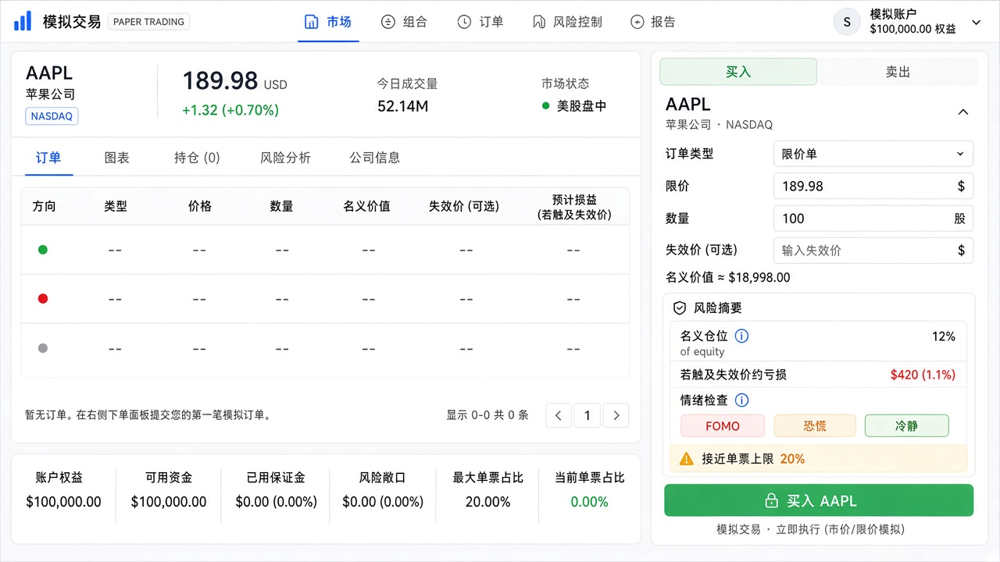
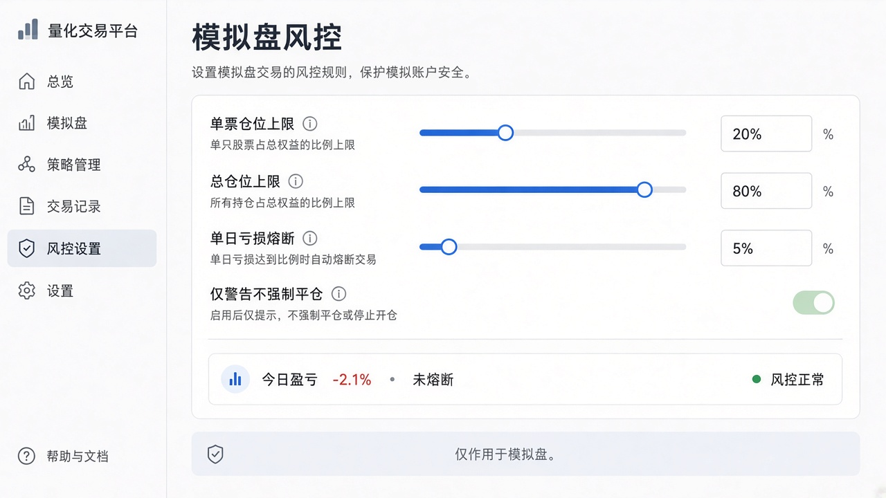

# PRD：模拟盘风险控制（冷静投）

| 项 | 内容 |
|---|---|
| 产品 | 钱力股 / Q-Stock |
| 范围 | **模拟交易**账户与个股下单动线；工具与 AI 冷静层衔接 |
| 状态 | **规划稿**（未开工实现） |
| 优先级 | P0 下单前仓位预填 + 软提示 → P1 账户规则 → P2 规则单增强 |
| 相关 | [仓位风险工具](./tool-position-sizing.md) · [策略与回测](./strategy-and-backtest.md) · [个股交易台 UI](./symbol-trading-ui.md)（含 **§4.5.1 交易抽屉 IA P0**） · [富途模拟规划](./symbol-advanced-and-futu-paper.md) · [行情 AI](../行情AI功能.md) · [路线图](../product-roadmap.md) |

---

## 1. 背景与目标

用户在模拟盘常「凭感觉下单」：仓位过大、无止损、追涨报复交易。产品主张是**借力 AI 削弱贪婪/恐惧**，风险控制应落到**可执行的规则与提示**，而不是口号。

**成功标准**

- 下单前能看见「这笔最多亏多少 / 占权益多少」；可选一键按仓位工具或 AI 草稿预填数量。  
- 账户级有可配置上限（单票、总仓、单日亏损）；触达时**软拦或硬拦**行为清晰、可关（高级用户）。  
- 全程**不荐股、不下真单**；文案中性（「接近限额」而非「你太贪婪」）。

**非目标**

- 真券商保证金、强平、融资融券、机构 OMS。  
- AI 自动改仓 / 自动市价砍仓。  
- 多账户合规审计、监管报送。

---

## 2. 用户与场景

| 角色 | 场景 |
|---|---|
| 自学交易者 | 模拟买入前想限制「单笔最多亏账户 1%」 |
| 易冲动用户 | 连亏后仍加仓；需要单日熔断或情绪自检 |
| 用 AI 情景的用户 | 「预填并去下单」后仍要过风险条与自检再提交 |
| 工具用户 | `/tools/position` 算完数量 → 跳转个股模拟单已填好 |

---

## 3. 范围分层

### 3.1 P0 — 下单前（个股 RightRail「下单」）

| 能力 | 说明 |
|---|---|
| **风险摘要条** | 根据 qty、入场参考价、可选止损价（若类型为 stop，或用户填了「失效价」）估算：风险金额、占权益 %、名义仓位占权益 % |
| **仓位工具预填** | 链到 `/tools/position?symbol=&entry=`；或结果页 CTA「带回模拟单」经 query/session 写入 qty |
| **AI 草稿衔接** | 「预填并去下单」写入后展示横幅「AI 草稿 · 未提交」；风险摘要用预填后的 qty/价重算 |
| **情绪自检** | 贪婪/恐惧标签（不阻断）；可选写入订单备注字段（见数据模型） |
| **软提示** | 名义仓位 &gt; 配置阈值、或单笔风险 % &gt; 阈值时，CTA 旁黄字；仍可提交 |

### 3.2 P1 — 账户级规则（`/settings` 或 `/portfolio`「风控」）

| 规则 | 默认建议 | 触达行为 |
|---|---|---|
| `maxPositionPctPerSymbol` | 20% | 硬拦新开/加仓（可改软拦） |
| `maxGrossExposurePct` | 80% | 硬拦新开 |
| `maxDailyLossPct` | 5%（相对日初权益） | 硬拦当日新开；撤单/减仓仍允许 |
| `maxOrderNotionalPct` | 10% | 软提示或硬拦（设置项） |
| `forbidMarketIfMovePct` | 可选：日内涨跌 &gt; X% 禁市价 | 软提示「改用限价」 |

规则存用户配置；模拟撮合 API 服务端校验（防绕过前端）。

### 3.3 P2 — 规则单与过程

| 能力 | 说明 |
|---|---|
| **止盈+止损配对** | 开仓时可选附带 OCO 风格两条件单（模拟 Worker 扩展） |
| **分批建仓** | 总计划量拆 2–3 笔限价（仅生成多笔 pending，不智能择时） |
| **复盘消费** | `emotionTags` / `invalidationNote` 进 `/api/ai/review` |
| **统计条** | 近 7 日「情绪标签次数」「触达风控次数」（portfolio 小卡） |

### 3.4 Out of Scope

- 实盘 Brokers 风控、融资利率。  
- 期权保证金与组合保证金。  
- 跟单/社区晒单风控。

---

## 4. 功能说明

### 4.1 风险摘要计算（客户端 + 服务端可复用）

```text
equity          = PaperAccount.cashBalance + Σ(position.qty * mark)   // mark 用最新价；无价则用成本
entry           = limit/stop 价或 last
notional        = qty * entry
stop            = 用户失效价或 stop 单价格（可选）
perUnitRisk     = stop != null ? |entry - stop| : null
riskAmount      = perUnitRisk != null ? qty * perUnitRisk : null
riskPct         = riskAmount / equity * 100
positionPct     = notional / equity * 100
```

无止损时：只展示名义仓位 %，风险金额显示「未设止损 / 失效价」。

### 4.2 服务端下单校验（P1）

`POST /api/trading/orders` 在创建订单前：

1. 读 `PaperRiskSettings`（无则用默认）。  
2. 若 `maxDailyLossPct` 已触达 → `403` + `code: RISK_DAILY_LOSS`。  
3. 若加仓后单票市值占比 &gt; `maxPositionPctPerSymbol` → `403` + `code: RISK_SYMBOL_CAP`。  
4. 若总敞口 &gt; `maxGrossExposurePct` → `403` + `code: RISK_EXPOSURE`。  
5. 通过则照常撮合/挂单。

前端映射为可读文案 + 链到风控设置。

### 4.3 与 AI / 情绪

- AI `sizeHintPct ≤ 20` 已有；风控账户上限可更严，取更小者。  
- 情绪自检**默认不阻断**；设置可开「未勾选自检不可提交」（默认关）。  
- 文案禁区：指责句；用「接近单票上限」「单日亏损已触及熔断」。

### 4.4 与仓位工具

- `/tools/position` 结果 CTA：`去模拟下单` → `/symbol/{assetType}/{symbol}` 并带 `?qty=&limit=&side=`（或短时 sessionStorage）。  
- 个股下单区链：「用仓位工具算数量」。

---

## 5. 数据模型（草案）

```prisma
model PaperRiskSettings {
  userId                   String   @id
  maxPositionPctPerSymbol  Float    @default(20)
  maxGrossExposurePct      Float    @default(80)
  maxDailyLossPct          Float    @default(5)
  maxOrderNotionalPct      Float?   // null = 不限制
  blockMarketOnLargeMove   Boolean  @default(false)
  requireEmotionCheck      Boolean  @default(false)
  softOnly                 Boolean  @default(false) // true = 全部改软提示
  updatedAt                DateTime @updatedAt
  user                     User     @relation(...)
}

// PaperOrder 增量（P0 备注 / P1 起持久化）
// emotionTags   String[]  @default([])
// invalidationNote String?
// riskSnapshot  Json?     // { equity, notional, riskAmount, riskPct } 下单时快照
```

日初权益：Worker 或首次下单时写入 `PaperAccount.dayStartEquity` + `dayStartDate`（UTC 或美东，产品选一并写进设置说明）。

---

## 6. 信息架构与 UI

| 位置 | UI |
|---|---|
| 个股右栏「下单」 | 表单下方、CTA 上方：**风险摘要** + **情绪自检**；黄字软提示 |
| 冷静 Tab | 筹码预填不变；预填后回下单区见摘要 |
| `/portfolio` | 「今日风险」：盈亏 %、是否熔断、链到设置 |
| `/settings` 或 portfolio 子页 | 风控滑杆/数字输入 + 恢复默认 |
| `/tools/position` | CTA 带回模拟单 |

视觉：终端密度；无恐吓红闪全屏；熔断用明确横幅一行。

---

## 7. 文案要点（zh-CN 草案）

- 风险摘要：「名义仓位约占权益 {pct}% · 若触及失效价约亏损 {amount}（{riskPct}%）」  
- 未设止损：「未设失效/止损，无法估算单笔最大亏损」  
- 熔断：「今日模拟亏损已达上限，暂停新开仓；可减仓或明日再开」  
- 免责：「规则仅作用于站内模拟盘，不构成投资建议，与真实券商风控无关」

---

## 8. 分期与验收

### P0

- [ ] 下单区展示名义仓位占权益 %（有账户时）  
- [ ] 可选失效价输入 → 显示风险金额与 %  
- [ ] 情绪自检条（不阻断）  
- [ ] AI「预填并去下单」后风险摘要刷新  
- [ ] 仓位工具或 query 预填 qty（至少一种）  
- [ ] 无「建议买入」文案；文件 &lt;500 行拆分  

### P1

- [ ] `PaperRiskSettings` CRUD + 默认值  
- [ ] `POST /api/trading/orders` 服务端校验三上限  
- [ ] 前端错误码映射与设置入口  
- [ ] 日初权益与单日亏损熔断  

### P2

- [ ] 止盈止损配对单（模拟）  
- [ ] emotionTags 持久化并进复盘  
- [ ] portfolio 风控统计小卡  

---

## 9. 实现提示（工程）

| 模块 | 路径建议 |
|---|---|
| 纯计算 | `src/lib/trading/risk-math.ts` |
| 服务端校验 | `src/lib/trading/risk-guard.ts` + orders route |
| 下单区摘要 UI | `src/components/trading/order-risk-summary.tsx` |
| 设置 UI | `src/components/settings/paper-risk-settings.tsx` |
| 个股编排 | `symbol-order-rail.tsx`（下单/冷静）已规划 |

约束：1GB/1 核 — 风控校验用账户+持仓小查询，禁止全表扫描；日初权益用字段缓存。

---

## 10. 埋点（可选）

- `risk_summary_shown`  
- `risk_soft_warn` / `risk_hard_block`（带 code）  
- `risk_settings_save`  
- `position_tool_to_paper`  

---

## 11. 决策摘要

| 项 | 决定 |
|---|---|
| 作用域 | 仅模拟盘 |
| P0 | 透明摘要 + 情绪自检 + 预填衔接；默认软提示 |
| P1 | 账户上限服务端强制（可设 softOnly） |
| AI | 辅助预填与失效条件；不自动下单、不自动砍仓 |
| 真券商 | 不在本 PRD |

---

## 12. UI 示意稿

> 设计方向参考；实现以本文 §3–6 为准。

### 下单区 · 风险摘要 + 情绪自检（P0）



### 设置 · 账户风控规则（P1）


