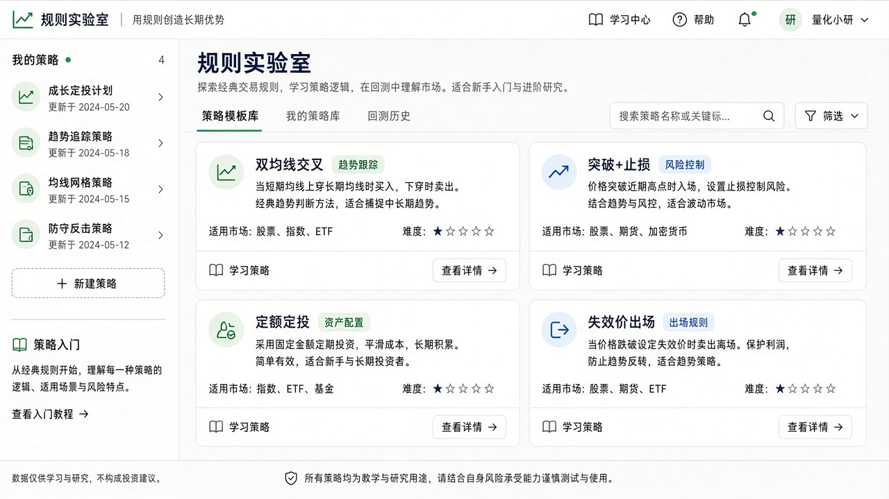
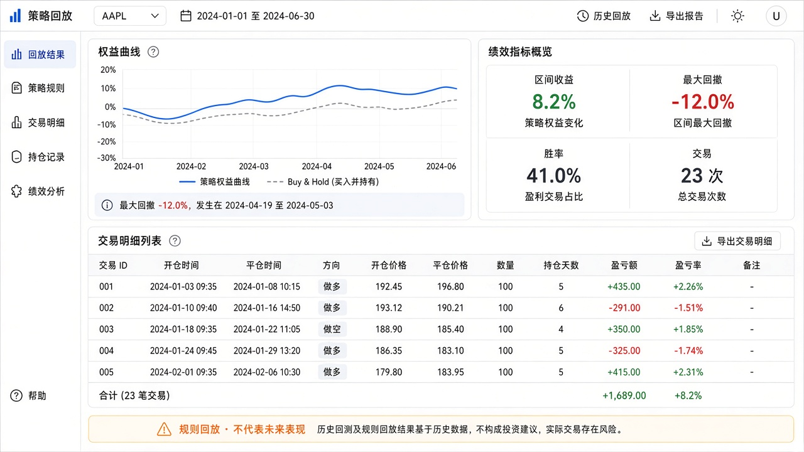

# PRD：交易策略与回测（规则实验室）

| 项 | 内容 |
|---|---|
| 产品 | 钱力股 / Q-Stock |
| 路由（建议） | `/lab` 或 `/strategies`（索引）；`/strategies/[id]`（详情/编辑）；`/strategies/[id]/replay`（回放） |
| 状态 | **P0/P1/P2 已落地**（对比 / 参数小表 / 多标的篮 / 分享 / AI 解读） |
| 优先级 | P0 策略模板+纸面挂钩 → P1 单标的规则回放 → P2 组合/对比/分享 |
| 相关 | [风险控制](./risk-control.md) · [仓位工具](./tool-position-sizing.md) · [个股 UI](./symbol-trading-ui.md) · [行情 AI](../行情AI功能.md) · [Learn 书单](../learn-reading-list.md)（慎把回测当能力） |

---

## 1. 背景与目标

用户常问：「按某个规则过去会怎样？」又容易把回测曲线当成圣杯。钱力股定位是**冷静投、过程复盘**，策略与回测应做成 **「规则实验室」**：写清规则 → 在历史 K 上**透明回放** → 可选挂到模拟盘练习，而不是量化交易平台。

**成功标准**

- 用户能用结构化表单（非代码）定义一条可解释规则，并在单个标的上看到交易点与权益曲线。  
- 结果页强制展示**假设与局限**（滑点、成交、幸存者偏差）；禁止「稳赚/必胜」文案。  
- 与模拟盘、仓位工具、风控、复盘打通：回放学规则，模拟练执行，复盘看过程。  
- 1GB/1 核：回放在 Worker / 限流 API，请求路径不扫全市场。

**非目标（本 PRD 明确不做）**

- 实盘自动交易、券商策略单托管。  
- 多品种组合优化、遗传算法、机器学习选股。  
- Tick/ Level-2 回测、期权路径依赖定价回测。  
- 保证收益、跟单社区、策略市场分成（可后置商业化另案）。

---

## 2. 用户与场景

| 角色 | 场景 |
|---|---|
| 自学交易者 | 「跌破 20 日均线就减仓」想看过去两年触发了几次 |
| Learn 学员 | 读完定投/仓位文，用实验室验证「固定买 vs 有止损」差异（教育向） |
| 模拟盘用户 | 把规则保存为「策略标签」，下单时挂标签，周末复盘按策略过滤 |
| AI 用户 | 情景给出的失效条件 → 存成规则草稿，再回放验证触发频率（辅助，非自动改规则） |

---

## 3. 概念定义

| 词 | 含义 |
|---|---|
| **策略（Strategy）** | 用户命名的规则包：入场/出场/仓位/标的范围 + 元数据（备注、标签） |
| **规则（Rule）** | 可机器判定的条件（均线交叉、跌幅、持有天数等） |
| **回放 / 回测（Replay）** | 在历史日 K（或限长分钟 K）上按规则模拟成交序列，输出指标与轨迹 |
| **纸面挂钩** | 策略不自动下单；可「生成下一笔模拟草稿」或「仅标签记录」 |

产品对内文案优先用 **「规则回放」**，对外可写「回测（学习向）」，避免量化平台预期。

---

## 4. 功能范围

### 4.1 P0 — 策略模板 + 纸面挂钩（无完整回测引擎）

| 能力 | 说明 |
|---|---|
| **策略库** | 内置 4–6 个只读模板（见 §5）；用户可「复制为草稿」编辑 |
| **我的策略** | 登录用户 CRUD：名称、备注、规则 JSON、关联 `assetType`/`symbol`（可空=通用） |
| **规则表单** | 积木拼装 + JSON 代码双模式（§5）；非流程图 IDE、非实盘脚本 |
| **挂到模拟** | 个股下单 / portfolio：选「策略标签」写入订单备注；**不自动下单** |
| **仓位衔接** | 规则里引用「单笔风险 %」时，链到 `/tools/position` 或内嵌同一公式 |
| **风控衔接** | 生成草稿时受 [risk-control](./risk-control.md) 上限约束 |

**验收焦点**：能保存策略、能在下单时打标签、模板可复制；尚无权益曲线也可上线。

### 4.2 P1 — 单标的规则回放

| 能力 | 说明 |
|---|---|
| **回放任务** | 选策略 + 单个 symbol + 区间（默认最长 2–5 年日 K，条数封顶） |
| **成交假设** | 信号日收盘价成交（可选项：次日开盘）；固定滑点 bps；忽略分红拆股或仅用后复权（二选一写死并披露） |
| **输出** | 交易列表、权益曲线、回撤、胜率、盈亏比、最大连续亏损次数；**无夏普也可 v1**（有则标注假设） |
| **图上标注** | 主图或迷你图标记买卖点（复用现有 K 线组件能力则优） |
| **导出** | 复制摘要 / CSV（可选） |
| **限流** | 每用户日 N 次；并发 1；超限排队或拒绝 |

### 4.3 P2 — 增强

| 能力 | 说明 |
|---|---|
| **双规则对比** | 同标的同区间两条策略并排曲线（定投模板 vs 有止损） |
| **多标的篮** | 自选 5–10 只依次回放汇总（Worker 批任务，禁止同步扇出） |
| **参数网格（极简）** | 单一参数 3–5 档（如均线 10/20/60），表格式结果；禁止大网格爆炸 |
| **分享** | 只读结果页链接（脱敏）；符合合规免责 |
| **AI 解读** | 「用这段回放写过程复盘」→ 调 review 语气，强调过拟合风险 |

### 4.4 Out of Scope

- Python/策略 IDE、自定义指标脚本上传。  
- 实盘同步执行。  
- 高频/逐笔回测。  
- 策略广场打分排行（易诱导跟风；若做须另 PRD + 强免责）。

---

## 5. 策略与规则规格

### 5.1 内置模板（P0）

| id | 名称 | 一句话 | 教学目的 |
|---|---|---|---|
| `ma-cross` | 双均线交叉 | 短均线上穿长均线开多，下穿平仓 | 理解滞后与震荡市磨损 |
| `break-stop` | 突破 + 固定止损 | 创 N 日新高买入，跌破入场价 X% 止损 | 风险预算直觉 |
| `dca-fixed` | 定额定投 | 每隔 M 个交易日买入固定金额 | 与 `/tools/dca` 对照「非收益承诺」 |
| `time-exit` | 持有 N 日必出 | 入场后 N 日市价了结 | 减少死扛 |
| `invalidation` | 失效价出场 | 手工/AI 给定失效价，跌破出场 | 对齐冷静情景 |
| `risk-sized` | 风险定仓 | 按权益 R% 与止损距算股数 | 对齐仓位工具 |
| `ma-above` | 均线上方持股 | 站上均线持有、跌破离场 | 最简趋势过滤 |
| `break-tp-sl` | 突破止盈止损 | 新高入场，止盈/止损先触先出 | 双边边界 |
| `ma-with-stop` | 金叉 + 止损 | 金叉入场，死叉或止损出场 | 趋势信号带风险框 |
| `ma-take-profit` | 金叉止盈 | 金叉入场，固定比例止盈 | 见好就收 |
| `weekly-dca` | 每周定投 | 约每 5 日定额买入 | 更密的定投节奏 |
| `short-break` | 短线突破 | 短窗口突破 + 短持必出 | 短持纪律 |
| `dual-barrier` | 止盈止损盒 | 金叉入场，止盈止损盒子 | 风险回报比入门 |

模板仅作起点；文案标明「历史规则回放 ≠ 未来收益」。API `ensureStrategyTemplates` 按 slug upsert。

### 5.2 规则 JSON 草案（P1 执行器）

```ts
type StrategyRules = {
  version: 1;
  market: "stock" | "hk" | "cn" | "crypto"; // 单策略单市场
  entry: RuleClause[];   // AND
  exit: RuleClause[];    // OR 先触先出 或 AND（配置）
  sizing: {
    mode: "fixedQty" | "fixedNotional" | "riskPercent";
    qty?: number;
    notional?: number;
    riskPercent?: number; // 需 stop 距离
    maxPositionPct?: number; // 与风控对齐
  };
  constraints?: {
    maxTradesPerDay?: number;
    cooldownBars?: number;
    allowShort?: boolean; // v1 默认 false，仅做多
  };
};

type RuleClause =
  | { type: "ma_cross"; fast: number; slow: number; direction: "up" | "down" }
  | { type: "price_vs_ma"; period: number; op: "gt" | "lt" }
  | { type: "drawdown_from_high"; lookback: number; pct: number }
  | { type: "hold_bars"; bars: number }
  | { type: "stop_pct"; pct: number }      // 相对入场
  | { type: "take_profit_pct"; pct: number }
  | { type: "price_level"; op: "lte" | "gte"; price: number }; // 失效价
```

v1 **仅做多**；空头/双边后置。指标仅用现有服务端可算的 MA 等，避免引入重型库拖垮 Worker。

### 5.3 回放输出指标（P1）

| 指标 | 必需 |
|---|---|
| 区间收益率、最大回撤 | 是 |
| 交易次数、胜率、平均盈亏比 | 是 |
| 终值权益（相对初始现金） | 是 |
| 夏普 / 卡玛 | 否（P2） |
| 买入持有基准曲线 | 是（同标的 buy&hold 对照，防自嗨） |

---

## 6. 信息架构与 UI

```text
/strategies
  · 模板卡片 | 我的策略
  · CTA：新建策略

/strategies/[id]
  · 规则表单（入场 / 出场 / 仓位）
  · 「保存」·「回放」·「用于模拟标签」

/strategies/[id]/replay
  · 标的搜索 + 日期区间
  · 结果：曲线 + 成交表 + 免责
  · 「把上一信号预填到模拟单」（若仍持有信号逻辑的「下一动作」）

个股页
  · 次级 Tab 或下单区：策略标签下拉（P0）
  · 不默认塞完整回测（避免个股页过重）
```

视觉：实验室感、表格与曲线清晰；**不做**炫酷「收益爆炸」营销大数字英雄区。

---

## 7. 技术与容量约束（1GB / 1 核）

| 原则 | 做法 |
|---|---|
| 预计算 / 异步 | `POST /api/strategies/replay` 入队；Worker 跑完写 `ReplayResult`；前端轮询或进页再读 |
| 条数上限 | 日 K 默认 ≤ 800～1200 根；超时 kill |
| 禁止 | 请求路径全市场扫描、并行 50 标的回测 |
| 缓存 | 同 strategyHash+symbol+range+假设 → TTL 缓存结果 |
| 行情 | 复用现有 candles API / Provider；失败软降级 |

---

## 8. 数据模型（草案）

```prisma
model Strategy {
  id          String   @id @default(cuid())
  userId      String?  // null = 系统模板
  slug        String?  // 模板 slug
  name        String
  description String?
  rules       Json
  isTemplate  Boolean  @default(false)
  createdAt   DateTime @default(now())
  updatedAt   DateTime @updatedAt
  @@index([userId])
}

model StrategyReplay {
  id           String   @id @default(cuid())
  userId       String
  strategyId   String
  symbol       String
  assetType    AssetType
  rangeFrom    DateTime
  rangeTo      DateTime
  assumptions  Json     // 成交价规则、滑点等
  status       String   // pending|running|done|failed
  result       Json?    // 指标 + trades[]
  error        String?
  createdAt    DateTime @default(now())
  @@index([userId, createdAt])
}
```

`PaperOrder` 可增 `strategyId String?`（P0 标签）。

---

## 9. 文案与合规

- 页眉/结果固定：「规则回放基于历史数据与简化成交假设，**不代表未来表现**，不构成投资建议。」  
- 结果区展示假设清单（成交价、滑点、是否复权、仅做多）。  
- 禁止：稳赚、必胜、跟单暗示。  
- Learn 互链：`checklist-three`、`risk-before-size`；书单导读「别把回测曲线当能力」。

---

## 10. 分期验收

### P0

- [x] `/strategies` 列出模板 + 我的策略  
- [x] 复制模板 → 编辑名称/备注/基础字段 → 保存  
- [x] 模拟下单可选策略标签并落库  
- [x] 与仓位工具文档/链接打通  
- [x] 无自动下单、无真券商接口  

### P1

- [x] 单标的回放任务异步完成并展示曲线+成交表+买入持有对照  
- [x] 假设与免责可见；日限流生效  
- [x] Worker 超时/失败有可理解错误  
- [x] 回放不拖垮 Web 进程（分进程或队列）  

### P2

- [x] 双策略对比或小参数表  
- [x] 分享只读结果  
- [x] AI 过程解读（可选）  
- [x] 多标的篮（Worker 依次回放）  

---

## 11. 实现提示

| 模块 | 建议路径 |
|---|---|
| 规则类型与校验 | `src/lib/strategy/rules.ts` |
| 回放引擎（纯函数） | `src/lib/strategy/replay-engine.ts` |
| API | `src/app/api/strategies/*` |
| Worker 任务 | 现有 worker 增 `runStrategyReplays` |
| UI | `src/components/strategy/*`（列表、表单、结果） |

单文件 &lt;500 行；引擎与 UI 分离便于单测（固定 K 线夹具）。

---

## 12. 与相关 PRD 的边界

| 能力 | 归属 |
|---|---|
| 单笔风险 %、账户熔断 | [risk-control](./risk-control.md) |
| 定投终值假设（非历史） | [tool-dca](./tool-dca.md) |
| 期权结构估算 | [tool-options](./tool-options.md) |
| AI 情景草稿 | 行情 AI + 个股冷静 Tab |
| 历史规则回放 | **本 PRD** |

定投工具 **不**升级为完整回测；需要历史路径时跳转本实验室的 `dca-fixed` 模板。

---

## 13. 决策摘要

| 项 | 决定 |
|---|---|
| 产品名语气 | 「规则实验室 / 规则回放」，慎用「量化回测」 |
| v1 方向 | 仅做多；日 K；单标的 |
| 执行 | 不自动实盘；可选模拟标签 / 草稿 |
| 性能 | Worker 异步 + 条数/次数封顶 |
| 合规 | 假设披露 + 买入持有对照 + 禁止收益承诺 |

---

## 14. UI 示意稿

> 设计方向参考；实现以本文 §4–6 为准。语气保持「规则实验室」，结果页必须有免责条。

### 策略库 / 模板索引（P0）



### 单标的回放结果（P1）


