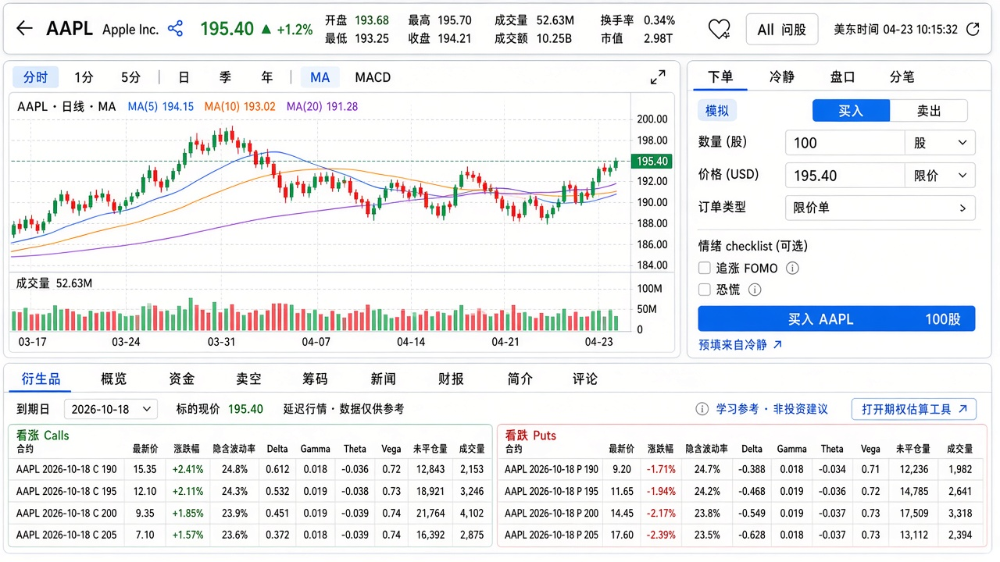
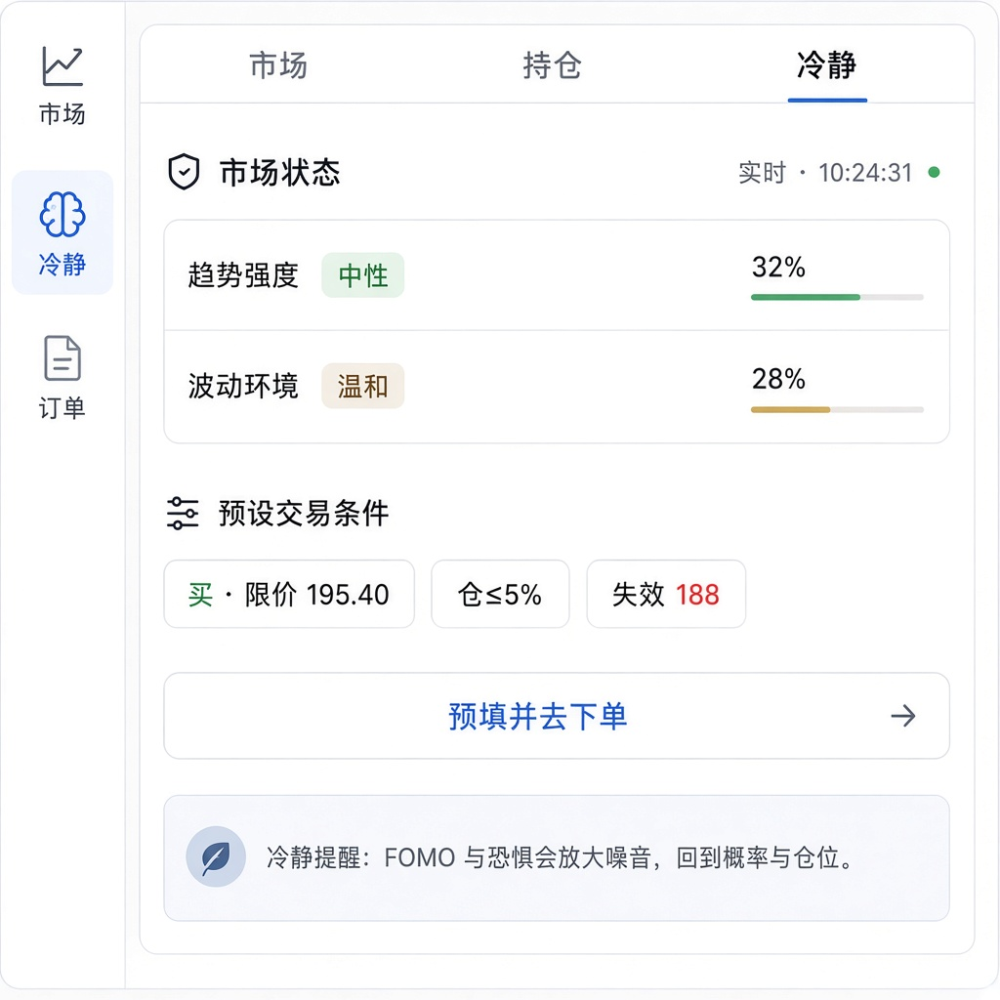
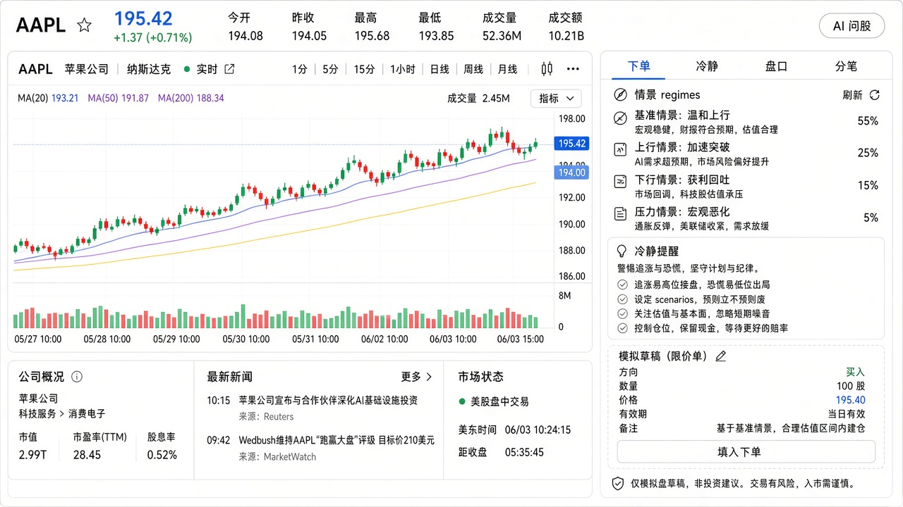
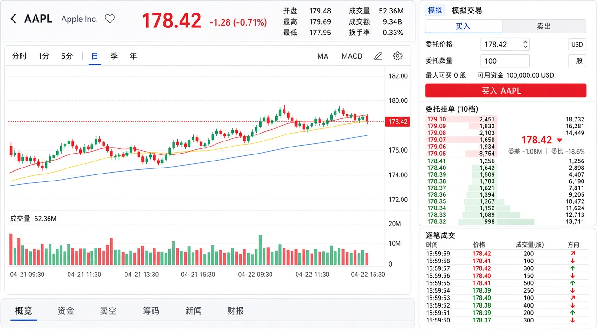
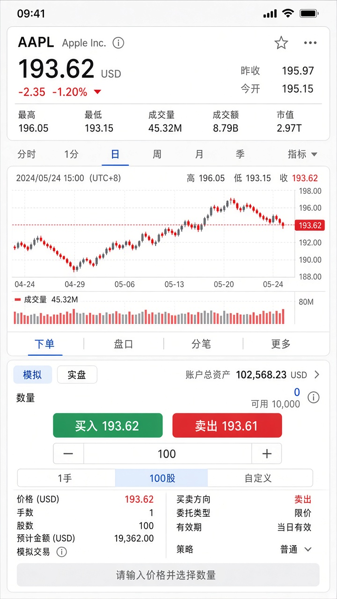

# 个股页 UI 改版 — 专业交易终端观感

> 状态：**设计稿 / 规划**（未改代码）  
> 目标：把 `/symbol/[assetType]/[symbol]` 从「功能堆叠面板」收成 **简洁、精专的金融看盘+下单台**，并把 **AI 问股 / 冷静情景 / 贪婪·恐惧检视** 嵌进下单动线（不是角落 FAB 孤岛）  
> 配套能力规划：[symbol-advanced-and-futu-paper.md](./symbol-advanced-and-futu-paper.md) · [行情 AI 功能](../行情AI功能.md)  
> 技术参考：[financial-chart-tech.md](../financial-chart-tech.md) · [longbridge-web-trade-tech.md](../longbridge-web-trade-tech.md)

---

## 1. 现状问题（为何显「粗糙」）

对照当前实现（[`symbol-page-client.tsx`](../../src/components/symbol/symbol-page-client.tsx)）：

| 问题 | 表现 |
|---|---|
| 信息层级碎 | Header、图表、提醒表单、Tabs、右侧交易栏各自一块 `qt-panel`，缝隙大、对齐弱 |
| 主次不清 | 图表与下方提醒/Tabs 同权重；交易栏与图表「并排但视觉脱节」 |
| 密度不够 | 大量 padding / `space-y-4`；专业终端偏「紧、齐、数字对齐」 |
| 工具散落 | 周期、指标、提醒、自选分属多行；缺少统一工具条 |
| 预留能力无位 | 分时、盘口、分笔、资金、卖空、筹码没有预留槽位，后续只能继续「往下堆」 |
| AI 与下单脱节 | [`SymbolAiFab`](../../src/components/symbol/symbol-ai-fab.tsx) 浮在角落；[`AiScenarioPanel`](../../src/components/market/ai-scenario-panel.tsx) 已有但未接入 [`TradePanel`](../../src/components/trading/trade-panel.tsx)；产品主张「削弱贪婪/恐惧」未出现在下单前 |

**改版原则**：一张主屏 = **报价条 + 主图 +（盘口|分笔）+ 下单（含 AI 冷静层）**；资讯/财报进次级区。AI **服务下单与复盘判断**，不另起一块营销墙。

---

## 2. 设计目标与非目标

### 目标

- **专业**：价格、涨跌、盘口、分时一眼可读；数字一律 `tabular-nums`
- **简洁**：默认一屏内完成「看图 + 挂单」；次级内容折叠或 Tab
- **精专**：美股/港股展示高级盘相关槽位；无权限时安静降级，不假数据
- **AI 融合**：问股、情景草稿、情绪检视嵌在右栏下单动线内；语气冷静，不荐股、不真下单指令
- **克制**：沿用现有色板（`--up` / `--down` / `--brand` / `--panel`），不做炫光、紫渐变、厚重卡片阴影

### 非目标

- 不做 Longbridge Pro 级多屏工作站一次性复刻
- 不做实盘下单 UI（模拟盘标识要清晰）
- **不做**「AI 说买就买」的一键市价；情景草稿仅限价/止损，且须用户确认
- 不改营销落地页视觉语言（个股页可略「终端化」，背景更素）

---

## 3. 布局蓝图

### 3.1 桌面（≥1280px）— 主工作台

```text
┌─ QuoteBar（单行，高约 48–56px）──────────────────────────────────────────┐
│ ← 代码 NAME  价 涨跌% │ OHLC/量 │ [分享] ♥ │ [AI 问股] 更新时间           │
└──────────────────────────────────────────────────────────────────────────┘
┌─ ChartToolbar（单行，高约 36px）──────────────────────────────────────────┐
│ 分时 1分 5分 │ 日 周 月 季 年 │  MA MACD … │          [图类型▾]          │
└──────────────────────────────────────────────────────────────────────────┘
┌─ MainChart（弹性高度，约 48–54vh）─┬─ RightRail（宽 340–380px）────────────┐
│                                  │  ┌─ RailTabs ─────────────────────┐  │
│   分时折线 / K 线 + 成交量         │  │ 下单 | 冷静 | 盘口 | 分笔        │  │
│                                  │  └────────────────────────────────┘  │
│                                  │  【下单】模拟 + 情绪自检 + CTA       │  │
│                                  │  【冷静】筹码预填 / 情景（无明细卡） │  │
│                                  │  【盘口】【分笔】                    │  │
└──────────────────────────────────┴───────────────────────────────────────┘
┌─ Secondary Tabs + 内容 ──────────────────────────────────────────────────┐
│ 概览 | 衍生品 | 资金 | 卖空 | 筹码 | 新闻 | 财报 | 简介 | 评论            │
│ （「衍生品」见 §4.9-D；问股抽屉 / 冷静右栏，不占次级 AI Tab）              │
└──────────────────────────────────────────────────────────────────────────┘
```

### 3.2 平板（768–1279）

- 右栏改为 **底部抽屉**：`下单 | 冷静 | 盘口 | 分笔`
- 主图仍占上半屏；QuoteBar 保留「AI 问股」入口

### 3.3 手机（&lt;768）

```text
QuoteBar（两行：价+涨跌 / 关键指标 + AI 问股图标）
ChartToolbar（横向滚动）
MainChart（约 40vh）
Segment: 下单 | 冷静 | 盘口 | 分笔 | 更多
Secondary Tabs（横向滚动）
FAB：仅作「AI 问股」二次入口（与 QuoteBar 同源打开抽屉）；下单主路径不依赖 FAB
```

---

## 4. 组件清单与视觉规格

### 4.1 QuoteBar（取代松散 Header）

| 元素 | 规格 |
|---|---|
| 代码 | 14–15px semibold，等宽感 |
| 名称 | 13px muted，truncate |
| 最新价 | 22–24px semibold tabular；涨红跌绿（跟随 `--up/--down` 与用户涨跌色设置） |
| 涨跌 | 13px，与价同色 |
| OHLC/量 | 11–12px muted 标签 + foreground 数字；桌面一排，手机隐藏次要项 |
| 操作 | 图标：返回、**分享**、自选；文字/图标按钮：**AI 问股**（打开现有 SideDrawer：读图 + 对话） |
| 分享 | 报价条旁菜单：Facebook / X(Twitter) / LinkedIn / WhatsApp / Telegram / 复制链接；有系统分享能力时额外「系统分享」；文案为代码+价+站名，非荐股 |

去掉：大面积 `QuoteStatsGrid` 卡片感 → 改为 **inline metrics**。

### 4.2 ChartToolbar

- 高度固定，底部分割线 `1px var(--border)`，背景 `var(--panel)` 或与页底同色（**减少双边框套娃**）
- 周期：`分时 | 1m | 5m | D | W? | Q | Y`（W 可选后续）
- 指标：小幽灵按钮，选中 = brand-soft 底，不描粗边
- 与主图区域 **合成一块**「图区」，外框最多一层

### 4.3 MainChart

- 高度：`min(580px, 54vh)` 桌面（为右栏冷静 Tab 留一点纵向呼吸）
- 加载：骨架条，不要整块居中「Loading」大字
- 十字线/坐标：字号 10–11px muted

### 4.4 RightRail — 下单

- 标题旁 **「模拟」** 小徽标（富途模拟上线后改「富途模拟」）
- Buy/Sell：**segment**，买=`--up` 轻底，卖=`--down` 轻底（非大彩钮满铺）
- 输入：统一 h-8/h-9，边框细，聚焦 ring 用 brand-soft
- 主 CTA：单色实心，文案「买入」/「卖出」，全宽
- 买一卖一：一行小字，可点回填限价
- **融合入口**（紧贴 CTA 上方或表单底部）：
  - 文字链「用 AI 情景填草稿」→ 切到 RailTab「冷静」并触发 `/api/ai/scenario`
  - 文字链「问这只股票」→ 打开 AI 问股抽屉（带当前 symbol）
- **提交前**：展开或内嵌 **情绪检视条**（§4.9）；不强制阻断下单，但默认展开一次（本地 `localStorage` 可记「今日不再提示」）

### 4.5 RightRail — 盘口 / 分笔

| | 盘口 | 分笔 |
|---|---|---|
| 表头 | 档位 · 价 · 量 | 时间 · 价 · 量 |
| 行高 | 22–24px | 22px |
| 量条 | 背景条按量比例，卖 `--down` 10% 透明，买 `--up` | — |
| 无权限 | 中部一行说明 + 链「高级行情」；**不要**灰掉假 10 档 |

### 4.6 Secondary Tabs

- 下划线 Tab（hairline），不用大胶囊堆
- 默认 Tab：**概览**（关键指标 + 提醒精简一行 + 可选一行 AI 趋势摘要）
- **衍生品**：美股 / 港股显示（§4.9-D）；`cn` / `crypto` / 指数隐藏或占位说明
- 美股/港股另显：资金、卖空、筹码；其它市场隐藏
- **不再**把「AI」作为与新闻同级的主 Tab（问股走抽屉；冷静走右栏）

### 4.7 提醒

- 从独立宽表单降为：概览内 **一行**「提醒：≥ / ≤ [价] [添加]」
- 或工具条「…」菜单内

### 4.8 间距与边框（反粗糙）

| Token | 建议 |
|---|---|
| 区块间隙 | 主工作台内部 `0` 或 `1px` 分割；区块之间 `8–12px` 而非 `16–24px` |
| 圆角 | 外框 `8px`；内部控件 `6px`；少用大圆角卡片 |
| 边框 | 优先用分割线，避免「框套框」 |
| 背景 | 个股页可用略深/素的 `--background`，去掉营销感径向光晕干扰（可局部覆盖） |

### 4.9 AI 融合规格（问股 · 冷静 · 贪婪/恐惧）

产品文案主张：「借力 AI，削弱贪婪、恐惧对人判断的干扰」。个股下单改版必须把这句话落到 **控件与动线**，而不是页脚口号。

#### A. AI 问股（对话 + 读图）

| 项 | 规格 |
|---|---|
| 入口 | QuoteBar「AI 问股」；右栏下单区「问这只股票」；手机 FAB 同源 |
| 载体 | 复用现有 `SideDrawer` + `AiChartReadPanel` + `AiChatPanel`（[`symbol-ai-fab.tsx`](../../src/components/symbol/symbol-ai-fab.tsx)） |
| 上下文 | 锁定当前 `symbol` / `assetType`；可预填一句「我正准备模拟买入/卖出，帮我核对失效条件」 |
| 禁止 | 抽屉内不出现「立即市价买入」按钮；不伪造报价 |

#### B. 冷静情景（嵌右栏 Tab「冷静」）

复用 [`AiScenarioPanel`](../../src/components/market/ai-scenario-panel.tsx) + [`/api/ai/scenario`](../../src/app/api/ai/scenario/route.ts)。

**弃用交互（现状问题）**：独立「模拟草稿」卡片罗列方向/数量/价格/备注 +「填入下单」——与下单表单字段重复、多一跳、备注散文难扫、和情绪自检脱节。见 §4.9-B2 替代方案。

| 元素 | 行为 |
|---|---|
| regimes | 延续 / 震荡 / 失效等，含概率与 **失效条件** |
| paperDraft | 仅 `limit` / `stop`；`sizeHintPct ≤ 20`；**不自动提交**；写入方式见 B2 |
| calmReminder | 固定展示，语气冷静 |
| 免责 | 固定：「仅模拟盘草稿，非投资建议」 |

未登录：内嵌 `AiLoginGate`（高度压缩）。额度不足：沿用现有额度徽章与拦截。

#### B2. 草稿 → 下单：交互方案（择一为主）

| 方案 | 交互 | 优点 | 缺点 | 推荐 |
|---|---|---|---|---|
| **A. 表单内联预填** | 点情景结果后的主按钮「预填到下单」→ **立刻切到「下单」Tab**，表单字段高亮闪一下；顶部一条可关横幅「AI 草稿 · 未提交」含「撤销预填」 | 零重复卡片；用户在真实下单区完成情绪自检与提交 | 冷静 Tab 上草稿摘要变弱 | **主推** |
| **B. 价位筹码** | 冷静区不出现完整草稿卡；只出可点筹码：`买 · 限价 195.40` `仓≤5%` `失效 188`；点筹码 **直接改下单表单对应字段**（可多点组合） | 终端感强、信息密度高；和盘口/图上挂价习惯一致 | 备注/rationale 需另处一行小字 | **主推搭配 A** |
| **C. 图上挂价** | 情景 `watchLevels` / draft.price 在主图画虚线；点线或右侧「用此价」写入限价 | 看图决策最自然 | 实现成本高（图表叠加层） | P1 |
| **D. 提交前确认条** | 无「填入」步：用户在下单区改好后点提交 → 底部确认条汇总「买 100 @195.40 · 情绪标签 · 失效价」再确认 | 一气呵成；适合已会用表单的用户 | AI 情景与表单的「第一次桥接」仍要 A/B | 作提交层，不替代预填 |
| **E. 对比双栏（不推荐）** | 左草稿卡右表单并排 diff | 适合改价审计 | 窄右栏放不下，正是现卡粗糙感来源 | **不做** |

**主推组合（落地规格）**

```text
冷静 Tab
  · regimes 列表（轻）
  · 一行 calmReminder
  · 筹码条：[买·限价 195.40] [仓≤5%] [失效看 188]   ← 点击即写入下单表单
  · 主按钮：「预填并去下单」→ 切 Tab + 横幅「AI 草稿 · 未提交」
  · 不渲染方向/数量/价格/备注明细卡

下单 Tab
  · 表单（真实唯一编辑面）
  · 情绪自检条
  · CTA「买入/卖出」
  · 可选：提交前确认条（方案 D）
```

**文案**：主按钮用「预填并去下单」或「用此限价」，避免「填入下单」被误解为已下单。  
**编辑**：草稿字段只在下单表单改；冷静区不再放铅笔编完整卡。

#### C. 贪婪 · 恐惧检视（下单前一等公民）

**目的**：让用户在点「买入/卖出」前用 5–10 秒对照人性弱点，而不是事后才在复盘里看到 `emotionFlags`。

**UI（情绪检视条，默认在 CTA 上方）**

```text
┌─ 下单前自检（可折叠）─────────────────────────────────┐
│ 今天这笔更像： [ ] 追涨/FOMO  [ ] 恐慌割肉              │
│               [ ] 报复交易    [ ] 加仓过猛              │
│               [ ] 无计划重来  [ ] 以上都不是（冷静）     │
│ 失效价？ [____]   这笔最多占现金/仓位 __%               │
│ 小字：勾选不阻断下单；会记入本笔模拟单备注，供复盘引用   │
└───────────────────────────────────────────────────────┘
```

| 规则 | 说明 |
|---|---|
| 不阻断 | 勾选「追涨」仍可提交模拟单——产品要的是觉察，不是说教墙 |
| 写入订单 | `PaperOrder` 增加可选 `emotionTags: string[]` + `invalidationNote?`（或 JSON `meta`）；复盘 [`/api/ai/review`](../../src/app/api/ai/review/route.ts) 优先消费这些标签 |
| 启发式提示（可选，本地规则，不调模型） | 例：日内涨幅 &gt; X% 且 side=buy → 轻提示「接近追涨场景，建议先看冷静 Tab」；大跌后市价卖 → 「接近恐慌抛售场景」。提示一行 muted，可关 |
| 文案禁区 | 禁止「你很贪婪」「你很恐慌」指责句；用「这笔更像…场景」中性标签 |
| 视觉 | 无红闪、无恐吓插画；hairline 框 + 小复选框；与交易表单同密度 |

#### D. 衍生品 Tab（次级）

> 对齐 [tool-options.md](./tool-options.md) 与路线图：**学习向 / 风险语言**；个股页不做期权实盘下单。

| 市场 | 展示 |
|---|---|
| `stock`（美股） | 近月到期选择 + Call/Put 简表（行权价 · 最新 · 涨跌 · IV）；无链数据时空态 |
| `hk`（港股） | 权证/牛熊证摘要位（有源则表，无源则说明）；链到学习工具 |
| 其它 | Tab 隐藏，或一行「本市场暂不提供衍生品视图」 |

**布局（桌面，选中「衍生品」时）**

```text
┌─ 到期 [2026-10-18 ▾]  ·  标的 195.40  ·  IV 摘要（若有） ──────────────┐
│ 筛选：全部 | 实值附近 | 虚值   链到「期权估算工具」                     │
├─ Calls ─────────────┬─ Puts ────────────────────────────────────────┤
│ Strike  Last  Chg%  │ Strike  Last  Chg%                            │
│ … 紧凑表，行高 22px  │ …                                             │
└─────────────────────┴───────────────────────────────────────────────┘
│ 脚注：仅供学习参考，非投资建议；不提供期权模拟/实盘下单                   │
│ CTA：打开 /tools/options（预填标的现价） · 问股「解释这份结构」         │
```

**规则**

- 无数据：不造假链；空态 + 工具链 + 一句合规提示  
- 与正股模拟下单隔离：衍生品 Tab **无**「填入下单」到股票 TradePanel  
- 贪婪/恐惧：若用户从衍生品跳转工具，工具页自有免责；个股冷静层仍只管正股模拟单  

#### E. 与次级「趋势 AI / 情绪舆情」的边界

| 能力 | 位置 | 说明 |
|---|---|---|
| AI 问股（对话） | 抽屉 | 主路径入口在 QuoteBar / 下单链 |
| 冷静情景 + 草稿 | 右栏「冷静」 | 直接服务模拟下单 |
| 贪婪/恐惧自检 | 下单 CTA 前 | 本地标签 + 可选启发式 |
| 衍生品 | 次级 Tab | 链/摘要 + 链到期权工具；不下单 |
| 舆情 sentiment Tab | 可保留在次级或并入概览 | **市场多空舆情 ≠ 个人贪婪恐惧**；不要混成一个 Tab |
| 趋势分析 aiAnalysis | 概览一行摘要即可 | 详细仍可点开 |

---

## 5. 状态与空态

| 状态 | UI |
|---|---|
| 报价加载 | 价区骨架；图区骨架 |
| 分时无数据 | 图中轻提示「今日暂无分时」 |
| L2 未授权 | 盘口/分笔占位文案 + `/advanced-quotes` |
| L2 失败 | 「深度暂不可用」重试；不回填假数 |
| 非交易时段 | 分时冻结最后点；盘口可停轮询 |
| 指数 / 加密 | 隐藏盘口·分笔·资金·卖空·筹码；右栏保留下单+冷静（若允许模拟） |
| AI 未登录 | 冷静 Tab / 问股抽屉：登录门；下单表单仍可用（若产品允许游客看盘） |
| AI 额度用尽 | 冷静/问股提示额度；**不阻断**手动填单下模拟单 |
| 情景无草稿 | `paperDraft=null` 时只展示 regimes + calmReminder，隐藏「填入下单」 |

---

## 6. 与能力规划的槽位对应

| UI 槽位 | 数据 / 能力 |
|---|---|
| 分时 / 1m / 5m | 分钟 K API（advanced 规划） |
| 盘口 | Depth API + `ADVANCED_QUOTES_ENABLED` |
| 分笔 | Trades API |
| 资金 / 卖空 Tab | 资金流 / short stats |
| 筹码 Tab | Volume Profile 本地计算 |
| 下单「富途模拟」 | `PAPER_TRADE_BACKEND=futu` |
| AI 问股抽屉 | 现有 `/api/ai/chat` + chart-read |
| 冷静 Tab | 现有 `/api/ai/scenario` → 填 `TradePanel` |
| 情绪标签 | 新：下单 meta → review `emotionFlags` |
| 衍生品 Tab | 期权链/权证摘要（有源）或空态 + `/tools/options`；**不下单** |

UI 可先按槽位改版（盘口/分笔用占位；冷静先接已有 scenario；衍生品可先空态+工具链），再按能力切片接数。

---

## 7. 实现拆分建议（工程）

保持 &lt;500 行/文件：

| 文件 | 职责 |
|---|---|
| `symbol-workbench.tsx` | 桌面三区编排（QuoteBar+Chart+Rail） |
| `symbol-quote-bar.tsx` | 紧凑报价条 + AI 问股入口 |
| `symbol-share-button.tsx` | 社交分享菜单（已实现于 Header；改版时迁入 QuoteBar） |
| `symbol-chart-dock.tsx` | 工具条 + 主图一体 |
| `symbol-order-rail.tsx` | RailTabs：下单 / 冷静 / 盘口 / 分笔 |
| `symbol-emotion-check.tsx` | 贪婪·恐惧自检条（可复用于提交确认） |
| `symbol-secondary-tabs.tsx` | 次级 Tab（现 TabsPanel 瘦身，去掉主 AI Tab） |
| `trade-panel.tsx` | 接 `onApplyDraft`、提交时带上 `emotionTags` |
| `ai-scenario-panel.tsx` | 嵌入冷静 Tab；样式改终端密度 |
| `symbol-ai-fab.tsx` | 与 QuoteBar 共用 open 状态；避免双入口状态分裂 |
| `use-symbol-page.ts` | 状态；盘口轮询 / AI drawer open 另钩子 |

**建议实施顺序**

1. 布局 + QuoteBar/ChartDock（视觉）  
2. **右栏接入冷静 Tab + 情绪检视 + 问股入口**（复用已有 API，立刻体现产品差异）  
3. 分时 → 盘口分笔  

---

## 8. 验收（UI）

- [ ] 桌面：一屏内同时看到价、主图、下单；无需先滚动  
- [ ] 报价条单行（或手机两行），无大卡片指标墙；含 **AI 问股** 入口  
- [ ] 图与工具条视觉一体，框线不超过一层  
- [ ] 右栏 Tabs：`下单 | 冷静 | 盘口 | 分笔`；滚动不丢粘性  
- [ ] 冷静区用 **价位筹码 +「预填并去下单」**，无「模拟草稿」明细卡；写入限价/止损后须在下单 Tab 确认，**不自动提交**  
- [ ] 下单前可见贪婪/恐惧类自检；中性文案；可选写入模拟单备注  
- [ ] 问股抽屉与右栏冷静不互相抢主导：一个对话、一个结构化情景  
- [ ] 次级含 **衍生品**（美/港）；无链数据时空态+工具链，无假链、无期权下单  
- [ ] 次级 Tab 不默认抢走视线；提醒不占独立宽面板；无「AI」大 Tab 与问股重复  

- [ ] 涨跌色、数字对齐、无权限/无额度空态符合 §4–5  
- [ ] 深色/浅色均可读；无新增发光/厚阴影皮肤  
- [ ] 全程无「市价立刻买入」类 AI 指令按钮  

---

## 9. 线框对照（ASCII）

**改前（示意）**

```text
[  大 Header 卡片 + 指标网格  ]
[  图表 ]     [ 交易卡片 ]
[  提醒整条表单              ]
[  Tabs … AI …              ]     ← AI 与下单脱节
                      (FAB 问股)
```

**改后（示意）**

```text
[ QuoteBar … [AI 问股] ]
[ 工具条+主图 一体  | 下单|冷静|盘口|分笔 ]
[                   | 情绪自检 + 表单/情景 ]
[ 次级 Tabs（无重复 AI 主 Tab） ]
```

**下单动线（目标）**

```text
看图 →（可选）AI 问股核对失效条件
     → 冷静 Tab 出情景草稿 → 填入限价/止损
     → 情绪自检勾选 → 确认模拟单
     → 日后复盘消费 emotionTags
```

---

## 10. UI 示意稿

> 示意稿为设计方向参考，实现以本文 §3–4 规格为准（控件文案、数据以真实组件为准）。

### 完整桌面工作台（含衍生品 Tab）



### 冷静草稿替代交互（筹码 + 预填，无明细卡）



### 桌面 · 右栏「冷静」+ AI 问股入口



### 桌面工作台（下单/盘口总览）



### 手机


