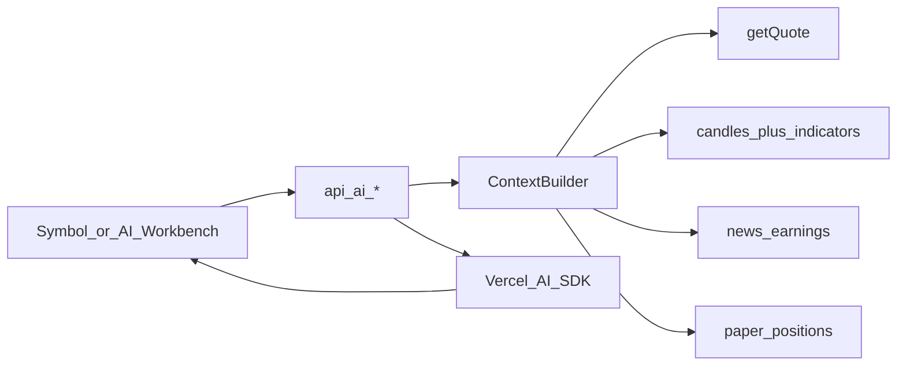

# AI 行情能力实现方案（对齐钱力股）

## 产品原则（贯穿五件事）

钱力股定位是「借力 AI，更冷静看盘与复盘」，不是荐股机器人。所有产出必须：

- 结构化（`generateObject` / 工具调用结果可渲染），避免长篇玄学
- 带数据出处（新闻条数、K 线条数、报价时点）与免责声明（复用现有 [`ai.disclaimer`](messages/zh-CN.json)）
- **禁止**「建议买入/卖出 X 手」类实盘指令；「下单建议」降级为情景假设 + 可一键填入**模拟盘**的草稿

复用已有底座：

- AI：[`src/lib/ai/client.ts`](src/lib/ai/client.ts)（BYOK + DeepSeek env）、[`analyze-trend.ts`](src/lib/ai/analyze-trend.ts)
- 行情：[`/api/quotes`](src/app/api/quotes/route.ts)、[`/api/candles`](src/app/api/candles/route.ts)、news/earnings/company
- 交易：仅 [`Paper*`](prisma/schema.prisma) + [`/api/trading/*`](src/app/api/trading)



---

## 公共基建（先做，五件事共用）

在 `src/lib/ai/` 抽一层，避免每个功能各拉一遍行情：

| 模块 | 职责 |
| --- | --- |
| `context/symbol-snapshot.ts` | 单标的：报价 + 近 N 根日 K 摘要 + 已有 MA/RSI/MACD + 新闻/财报摘要（从 `analyze-trend` 拆出可复用部分） |
| `context/candle-features.ts` | 把 K 线压成模型友好特征：近 60 根 OHLCV、涨跌幅序列、关键位（近高/近低）、指标数值；**不喂原始超长数组** |
| `guardrails.ts` | system prompt：不作投资建议、不编造未提供的数据、输出必须引用上下文字段 |
| `usage.ts` | 可选：按用户/日限流（防 BYOK 被刷；平台 Key 更要限） |

API 统一前缀：`/api/ai/*`，一律 `auth()` + `resolveAiConfig(userId)`。

---

## 1. 对话式问股

**入口：** 标的详情右侧/底部「问股」抽屉；后续可在 `/analysis` 加全局入口（默认带当前 symbol）。

**实现：**

- `POST /api/ai/chat`：`streamText`（Vercel AI SDK），多轮消息存客户端即可（一期可不落库）；登录用户可后续加 `AiChatThread` 表
- **Tools（强制接地）：**  
  - `get_quote` / `get_candles_summary` / `get_news` / `get_earnings` / `get_existing_trend`（调现有 `analyzeTrend` 缓存）
- 无 tool 结果时模型不得编造价格
- UI：[`ai-analysis-panel`](src/components/market/ai-analysis-panel.tsx) 旁新增 `ai-chat-panel.tsx`；流式用 `useChat` 或自管 SSE

**范围限制（一期）：** 每次会话锁定 1 个 `symbol+assetType`；问「对比别的票」时引导去对比报告页。

---

## 2. 多标的对比报告

**入口：** `/analysis` 增强：多选 2–4 个标的 →「生成对比」；或自选页多选。

**实现：**

- `POST /api/ai/compare`：body `{ items: [{symbol, assetType}] }`（max 4）
- 服务端并行 `symbol-snapshot` × N，再 `generateObject`：

```ts
z.object({
  overview: z.string(),
  dimensions: z.array(z.object({
    name: z.string(), // 估值/动量/情绪/风险等
    ranking: z.array(z.string()), // symbol 序
    note: z.string(),
  })),
  calmTakeaway: z.string(), // 强调「差异」而非「该买谁」
  risks: z.array(z.string()),
})
```

- UI：`/analysis/compare` 或详情内 Modal；表格展示维度排名 + 摘要；缓存 key 按 sorted symbols（`ApiCache` 已有表可复用，TTL 30min 对齐趋势分析）

---

## 3. 自动复盘笔记

**入口：** 资产概览 / 模拟成交列表「生成复盘」；也可定时（收盘后）对当日 `filled` 订单。

**数据源（已有）：** `PaperOrder`（filled）+ `PaperPosition` + 成交时点前后的 quote/candles 摘要。

**实现：**

- Prisma 新表 `ReviewNote`：`userId`, `period`（day/week）, `content`（JSON 结构化）, `sourceOrderIds[]`, `createdAt`
- `POST /api/ai/review`：汇总区间成交 → `generateObject`：

```ts
z.object({
  whatWentWell: z.array(z.string()),
  whatToImprove: z.array(z.string()),
  emotionFlags: z.array(z.string()), // 追涨杀跌/报复交易等标签
  nextChecklist: z.array(z.string()), // 下次开盘前冷静清单
  summary: z.string(),
})
```

- UI：[`portfolio`](src/app/[locale]/portfolio/page.tsx) 增加「复盘」卡片；对齐产品文案「削弱贪婪恐惧」——`emotionFlags` 是一等公民，不是涨跌归因堆砌

**不做：** 自动发邮件荐股；可选「保存笔记」手动触发即可。

---

## 4. 「实盘下单建议」→ 冷静情景 + 模拟草稿（明确不做真下单）

与产品合规一致：**不接券商实盘、不输出市价下单指令。**

**实现成：**

- `POST /api/ai/scenario`：输入当前标的 + 可选持仓/现金（来自 PaperAccount）
- 输出结构化「情景」而非订单：

```ts
z.object({
  regimes: z.array(z.object({
    name: z.string(),       // 如 延续/震荡/失效
    probability: z.number(),
    invalidation: z.string(), // 什么情况这份假设作废
    watchLevels: z.array(z.number()),
  })),
  paperDraft: z.object({
    side: z.enum(["buy","sell"]).optional(),
    type: z.enum(["limit","stop"]).optional(),
    price: z.number().optional(),
    rationale: z.string(),
    sizeHintPct: z.number().max(20), // 建议仓位上限很低，强化冷静
  }).nullable(),
  calmReminder: z.string(),
})
```

- UI：详情交易侧栏增加「情景推演」；用户确认后才调用现有 `POST /api/trading/orders` 填限价/止损草稿
- 文案固定：「仅模拟盘草稿，非投资建议」

**个股工作台融合（UI 规划）**：见 [`prd/symbol-trading-ui.md`](./prd/symbol-trading-ui.md) §4.9 — 右栏 Tabs `下单 | 冷静 | 盘口 | 分笔`；问股入口进 QuoteBar；下单前增加贪婪/恐惧 **情绪自检条**（不阻断，写入模拟单 meta 供复盘）。

真券商（[`docs/longbridge-web-trade-tech.md`](docs/longbridge-web-trade-tech.md)）保持预留，**本方案不纳入排期**。

---

## 5. K 线形态喂给模型

**不要**把全量 candle JSON 塞进 prompt。采用特征层：

1. [`candle-features.ts`](src/lib/ai/)：从现有 candles API 同逻辑取日 K（60–120 根）
2. 服务端计算（已有指标可复用）：最近波动、距 MA 偏离、RSI 区、MACD 柱方向、局部 HH/HL、简易形态标签（如 `higher_highs` / `range` / `breakdown`——规则引擎先标，再给模型解读）
3. `POST /api/ai/chart-read` 或并入 chat tool `read_chart`
4. 输出：`structure` / `keyLevels` / `whatWouldChangeMind`（失效条件）——与「冷静复盘」同语气

可选增强（二期）：前端画线选区 → 只把该区间 features 送模。

---

## 分期落地（建议）

| 期 | 内容 | 原因 |
| --- | --- | --- |
| **P0** | 公共 Context + K 线特征 + 问股 Chat（单标的 + tools） | 复用详情页流量，立刻可感知 |
| **P1** | 对比报告（2–4）+ `/analysis` 多选入口 | 补入口页「空」的感知 |
| **P2** | 复盘笔记（基于模拟成交）+ 情景推演→模拟草稿 | 闭环「看盘→动手→复盘」，贴合品牌 |

---

## 关键文件落点

- 新建：`src/lib/ai/context/*`、`src/app/api/ai/chat|compare|review|scenario/route.ts`
- 扩展：[`symbol-tabs` / 详情页](src/components/symbol/)、[`analysis/page.tsx`](src/app/[locale]/analysis/page.tsx)、[`portfolio`](src/app/[locale]/portfolio/page.tsx)
- 文案：`messages/*.json` 增加 `aiChat` / `aiCompare` / `aiReview` / `aiScenario`
- Schema：仅 P2 需要 `ReviewNote`（及可选 `AiChatThread`）

---

## 风险与边界

- Token / 费用：对比与 chat 必须限标的数、截断新闻、复用 `ApiCache`
- 幻觉：工具调用 + Zod；UI 展示「基于 N 条新闻 / M 根 K 线」
- 合规：全链路免责声明；情景模块禁止 `market` 市价草稿默认勾选
- 文件体积：新 UI 拆 `ai-chat-panel.tsx` 等，遵守 500 行限制
